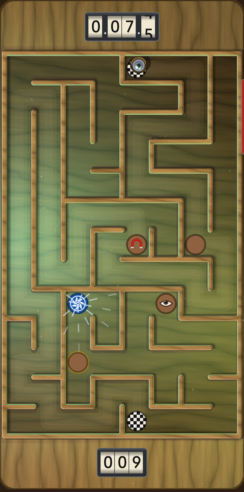
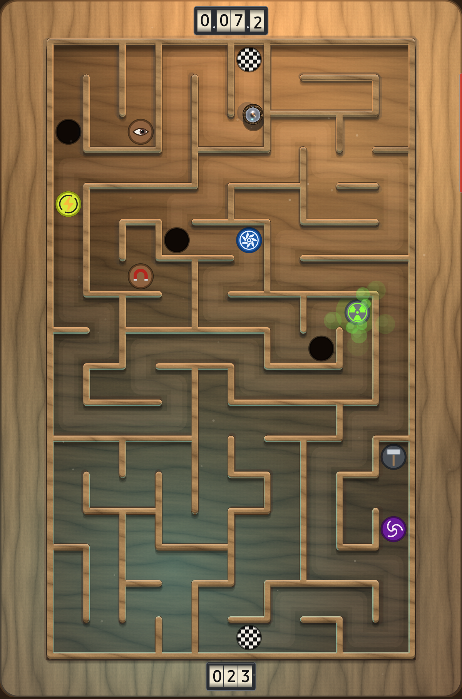

# Tilt Labyrinth

A wooden labyrinth board for Android: tilt the device to roll a chrome steel ball from the checkered start to the finish hole, past ten kinds of traps that run on a fixed rhythm. Written in Kotlin with Jetpack Compose; all graphics are drawn in code, the wood and the ball's mirror are GPU shaders, and every sound is synthesized.

<p>


</p>

## Playing

- Hold the device flat the way you'll play and tap: that hold becomes level. Tilt to roll the ball. Tap to pause; tapping again re-levels to the current hold and resumes. Back pauses the board too, and a second Back leaves the game with the run kept, paused; from free play or the test board, Back returns to the menu. The ball waits half a second at every start before gravity bites.
- Real rolling physics: the ball accelerates by the gravity component along the board (rolling-sphere factor), with rolling resistance, bounces that lose energy, and a fixed 1/600 s simulation step. Walls and holes are exactly as large as they are drawn.
- 100 fixed boards, identical for every player on every device, growing from 7x11 to 22x37 cells with more dead ends and more traps. Each board must be finished within three minutes, or the ball explodes and the run is over. The clock starts with the ball's first move.
- One save slot: after finishing a board, SAVE keeps the run; the main screen then offers LOAD to continue it. Tapping anywhere else starts a fresh run from level 1.
- Every finished board of the saved run is listed on the main screen with its medal and time; tapping one plays it again, unscored. Free play never asks for a name and never touches the boards.
- Medals: each board has a par time from a clean run; gold within 15% of it, silver within half again, bronze within double. The level-done card names the medal earned.
- The board shows the running time on pinball score reels in the top rail and the board number in the bottom rail, the same size on every board of a screen: on a phone they fill the spare room above and below the maze, on a tablet the rails make room for them.
- Every board is its own environment. The 100 boards travel through ten worlds (forest, seashore, desert, cave, temple, storm, snowfield, night meadow, volcano, starlight), ten boards each, and each board has its own tune, soundscape and lamp colours, all synthesized on the device from the board number, so every player gets the same world on the same board. The test board is silent. Hold the level counter at the bottom to mute or unmute the music; the game's own sounds stay. Each world has its own animals, synthesized like the music: cuckoos, woodpeckers and songbirds in the forest, gulls, seals and a far whale by the sea, coyotes and hawks in the desert, bats in the cave, monkeys and peacocks at the temple, wolves and chickadees in the snow, crickets, frogs and nightjars at night, and more; every board brings its own mix, near and far, left and right. Two pieces are composed by hand, about three minutes each and looping seamlessly: an adventure march for the main screen and the first board, and a victory theme for the last board, both played by a synthesized orchestra of brass, flute, strings, harp, bass, timpani, snare and bells. They ship with the game as recordings rendered from the same synthesizer, so they start playing at once. Finishing all 100 boards sets off fireworks all over the screen, each burst heard where it is. Music and ambience pause with the game.
- Lighting is alive and matches each world: a sun circles each board casting the shadows in the world's colours, warm when low and pale when high, three coloured lamps in the world's palette drift over the wood, the far side falls into the world's shade, and the wood itself takes on the world's tone (oak, driftwood, sand, slate, teak, birch, walnut, charred, ebony). The test board keeps plain red, green and blue lamps on brown wood. The lights move faster on higher boards.
- Trap sounds come from where the trap is: left, right or in between. The ball's knock on a wall follows the wall's length: a short stub ticks high, a long wall answers deeper, the frame thuds.
- The ball is a true chrome mirror of the board around it: walls, floor, trap lids, their glows and the lamps all reflect in it.

### Traps

All traps sit at fixed places with fixed timing per board, so every player meets the same sequence. Each one is heard and felt only when the ball is near, and all get quicker and stronger as the boards go up. Five of them end the run, five only trouble the ball.

| Killers | | Buggers | |
|---|---|---|---|
| **Hole** | a lid that blinks open; the ball drops in | **Magnet** | red field pulls the ball through walls and holds it |
| **Trapdoor** | an eye on the lid; arms when the ball comes near, then drops | **Wind** | a fan blows the ball away, blocked by walls |
| **Crusher** | a piston strikes after a warning; its blow kicks nearby balls | **Radioactive** | touching the leaking disc coats the ball in slow, sticky slime |
| **Laser** | fires a beam down the corridor; touching it destroys the ball | **Speed** | touching the charged disc drives the ball faster with a yellow halo |
| **Ice** | a slippery patch that cracks open into a hole | **Spinner** | a vortex current swirls the ball around |

The finish hole itself opens and shuts on a rhythm. Hold anywhere on the title for free play: it opens the test board (level 0), which has one of every trap and does not count, and rolling its level counter up or down opens any board from 1 to 100 to play unscored.

### Boards

- **Top 10** behind the TOP 10 button on the main screen (every card shrinks to fit a short phone): runs ranked by boards completed, then total time of those boards.
- **Top boards players** at the end of a run: the ten boards with the fastest times of all, with the player who set each.
- Your name is asked once, when the run ends.

## Building

Requires JDK 17+ and an Android SDK with platform `android-37.0` and build-tools 37. Regenerate the sound clips with `python3 tools/gen_sounds.py` after editing them, and the two written pieces with `tools/render_written.sh` (needs `oggenc` from vorbis-tools) after changing their scores; a unit test fails if the shipped recordings no longer match the scores.

```sh
./gradlew assembleDebug                 # app/build/outputs/apk/debug/app-debug.apk
./gradlew test                          # level fingerprint, trap simulations, leaderboards, music
./gradlew lintDebug lintRelease         # clean
./gradlew connectedReleaseAndroidTest   # the player's workflows on devices and emulators: every card must fit the screen
```

Release builds are signed with a keystore referenced by a `keystore.properties` file next to this README (not committed).

## Layout

- `app/src/main/kotlin/com/megapro/labyrinth/game/` — maze generation and the fixed level set, traps, rolling-ball physics (no Android types)
- `app/src/main/kotlin/com/megapro/labyrinth/ui/` — Compose rendering: board, wood and chrome shaders, lighting, traps, reels, dialogs
- `app/src/main/kotlin/com/megapro/labyrinth/audio/` — SoundPool wrapper, the per-board music and ambience synthesizer, the streaming player and the decoder for the two shipped recordings; `haptics/` — vibration; `data/` — leaderboard, save slot and settings storage
- `MainActivity.kt` — sensor handling, screen setup, music lifecycle, crash report (shown with COPY at the next start)

Minimum Android 8.0 (API 26), targets Android 17; the shader-based wood and mirror need Android 13, older devices get painted equivalents.
